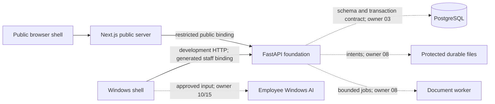

# Architecture

Date: 2026-10-13. Phase work began 2026-10-12; Phase 01 baseline remains dated 2026-10-12. Baseline: [product](../product/PRODUCT_SPEC.md), [quality](../product/QUALITY_ACCEPTANCE.md), [release](../product/RELEASE_CONTRACT.md) and [local AI](../product/LOCAL_AI_CONTRACT.md). This document defines Phase 02 architecture and records its implemented foundation. Application transactions, identity, document processing, scoring and inference remain with their numbered owners.

## Current modules

| Module | Implemented foundation | Future runtime owner |
| --- | --- | --- |
| `apps/desktop` | Tauri 2 Windows host, React/Vite shell, Vietnamese labels, explicit configuration, bounded service check and stale-selection cancellation | Full design 05; native transport/processes 14–15; artifacts 16–17 |
| `apps/web` | Next.js public shell, shared Fluent primitives, restricted generated public client, server-side API forwarding, nonce CSP and no-store responses | Browse 06, application 08, approved deployment 16–17 |
| `apps/api` | FastAPI factory; real liveness, unavailable dependency readiness, public/staff/configuration OpenAPI contracts and safe errors | PostgreSQL 03, identity 04, domain 06–12 |
| `apps/worker` | Owned loopback process and bounded queue/runner/cancellation interfaces; document runner absent | Document execution/storage 08–09 |
| `packages/foundation` | Sole typed settings owner, DTOs, separate AI schema factory, protected temporary input handles and trusted developer launcher interface | Actual model module 10; native integration 14–15 |
| `packages/api-client` | Actual generated public, staff, configuration and local-AI types; separate transport exports | Domain endpoints supplied by their owners |
| `packages/ui` | Modular official Fluent provider/button/text/theme, Radix icons, shared tokens and light/dark shells | Complete components/workflows 05 |
| `infra`, `tests`, `docs` | Development/test Compose definition, locked tooling, real process tests, browser inspections and dated evidence | Actual PostgreSQL qualification 03 |

There is no broker, employer portal, applicant account, hosted AI endpoint or generic microservice platform. No business record, score, applicant receipt or successful login is fabricated.

Solid paths are implemented shell/service paths. Dashed paths are required future runtime. Central FastAPI and the browser never run the employee model.

## Execution and distribution

Standalone owns a private local identity/database/file realm. Connected uses one approved HTTPS server and its canonical data. Neither mode shares sessions, caches or data with the other. A connected outage produces a connection error; it cannot start a local fallback, synchronize, switch mode or restore another realm's view. In this phase the validator fixes the realm/mode pair and the shell has no session or business cache. Native switching, device sessions and outage qualification remain UNVERIFIED owner 15.

Installed/portable is read from an independently validated native release manifest. It never selects standalone/connected. The developer shell is an unbundled executable requiring this workstation's tools and Evergreen WebView2. Private Python/PostgreSQL/Fixed Version WebView2, zero recipient setup, installer and single-EXE portable qualification remain UNVERIFIED owners 14–17.

Development/test use explicit HTTP loopback services with one bound socket and no replacement port. The embedded Windows origin `http://tauri.localhost` is Tauri's virtual origin, separately declared in the exact CORS allowlist; it is not a guessed API address. Production native transport is a Rust-owned, allowlisted bridge contract for 14–15: resolve service addresses from owned startup context; keep startup/staff secrets in native memory; attach current realm/session context; prohibit arbitrary paths, commands and remote destinations. The present shell exposes no native filesystem or HTTP command.

## Persistence and whole-command boundary

A future application service owns one whole-command PostgreSQL transaction: authenticate staff before selecting tenant context, recheck membership/role/record/purpose/consent, lock or compare the expected revision, resolve scoped idempotency against payload identity, write related entities and audit, then commit once. Replays recheck current authority. Conflicts and failed final checks roll back the entire command. Browser/native assertions, tenant headers, documents and AI reports grant no authority.

Relational references are tenant-consistent and versions/history immutable. Forward Alembic revisions belong to 03; startup `create_all` is prohibited. Current Alembic scaffolding deliberately has zero revisions and its environment refuses schema execution. `migration:check` verifies this scaffold, not a database upgrade.

External files use durable intents and protected staging: reserve a scoped intent, write and verify bytes, commit the associated database state, finalize the file, then reconcile pending intents after restart. SQL cannot atomically commit a filesystem write. Final authorization is rechecked before attachment, finalization, preview and export. Durable document storage and crash recovery remain UNVERIFIED owner 08. Release storage is protected local disk; development Compose contains PostgreSQL only and no S3 emulator.

Removal/restore retains permitted history. Privacy erasure removes private facts, files, scores, advice and equality/hash caches and advances the privacy epoch. Restore cannot recreate erased private derivations. Durable erasure and backup reconciliation remain UNVERIFIED owners 03/08/16/18.

Canonical calculation identity includes confirmed factual/evidence content, complete rubric/calculation definitions and any pinned reference date. Transport IDs, clock, filenames and advisory versions cannot change points. Integer/null ratings, exact weights, final half-up rounding, weighted Unknown and separate mandatory/stage rules follow the authorities. This phase implements no score calculator.

## Health and lifecycle

`/live` confirms the actual API/worker process can respond. `/ready` returns 503, `ready=false`, and `implemented_dependencies=[]`. It distinguishes shell, database-backed company/authentication, document and Windows-AI capabilities. No database/storage/model adapter is marked ready.

Future company commands require their own database/implementation capability; authentication requires its database/identity capability. Neither may depend on the future document runner or local model. Document readiness separately requires database, protected storage and a real document runner. Consumers must check the relevant capability; the aggregate readiness response cannot be a universal screen-unlock switch. Public capability responses currently state jobs/application unavailable. Staff requests always deny unauthenticated/unimplemented identity before tenant context.

Development ownership uses explicit profile/config arguments, strict bind, one socket passed to Uvicorn, bounded keep-alive and graceful shutdown. An opt-in owner stdin channel requests shutdown on STOP/EOF; no HTTP process-kill route exists. Worker admission requires a real runner, bounds queue and concurrency, and propagates cancellation/timeout. Model-task cancellation/status belongs to the separate AI contract and actual module owner 10.

## Model and developer harness

[The pinned manifest](../../contracts/model-manifest.json) defines E5 revision, six assets and hashes, tokenizer, copied MIT license digest, ONNX Runtime, prefixes/pooling/chunking/ranking versions and CPU provider. Artifact acquisition is a development/build operation through `model:fetch`; runtime processes do not import the fetcher. No external inference provider is supported.

The trusted Python launcher accepts a real `WindowsModelModule` object from Phase 10 code, validates Windows/component/profile and local artifacts, creates a fresh startup token, binds only the configured loopback AI endpoint and passes authority through a private owner callback. Requests require that token. No request can choose a module, process, path or remote destination. `StartupContext` supplies resource settings, a guarded input store and trusted model root. Bind ownership precedes recovery, so a colliding launcher cannot erase a live owner's inputs. A SHA-256 namespace separates input roots by configured realm; manifests from another realm are rejected before storage. The private owner callback receives a stop function; no HTTP shutdown command is exposed. The separate schema factory remains schema-only and always returns unavailable; it cannot stand in for the real module.

Protected temporary inputs have opaque random handles, a current-user protected Windows DACL, a configured total byte bound including metadata, and a local expiry no later than either the approved manifest deadline or configured task lifetime. Resolve checks current authority and removes revoked/expired inputs; remove/recover discard owned inputs. Task completion/cancellation and launcher shutdown must call cleanup. These are developer foundation contracts and synthetic file checks, not durable CV storage or real recruitment authorization.

Actual CV/JD vectors, Vietnamese findings/questions, both-mode execution, final server attachment guards, process peak budget and 100-CV quality/resource results remain UNVERIFIED owners 09–10/13/15/18. The artifact compatibility check executes the real CPU graph on two synthetic Vietnamese strings and measures that developer process using Win32 peak working-set counters. This qualifies the pinned kernel on this host only; it does not implement advice, establish a universal CPU baseline or qualify product memory/quality.
