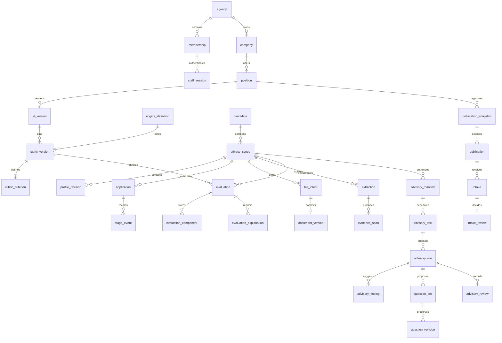

# Phase 03 persistence design

Date: 2026-10-13. Current head: `0017_used_definition_seals`, seventeen frozen forward migrations. Predecessor: exact Phase 02 `Gate decision: PASS`; all 253 recorded source/evidence hashes were verified before Phase 03 edits. The full supplied Phase 03 prompt governs this run.

The current nine-command checkpoint passed: formatting, lint, strict typing (36 files), tests (59 Python plus actual API/worker lifecycle), generated clients, database (94 real PostgreSQL tests plus query plans/catalog), migration lifecycle, infrastructure config and desktop/web builds. Commands/timestamps/logs are in evidence-03. The same independent reviewer has also approved this head; its scoped report is recorded in evidence-03/independent-review-0017.json.

The single reviewer Copernicus (`01a13300-1440-7733-87f9-04521f464566`) reported seven defects at 0010. Forward 0011–0017 now address all seven: exact decimal arithmetic, required revision/public pins, occurrence/history bindings, adapter-owned finalization with private non-consumable obligations for reads/mutations/replays, and full source/evidence calculation identity. All affected and full current checks pass. The same reviewer closed R1–R7 and the additional construction-time P1 at 0017 with PASS. No second reviewer was created. Final main evidence/requirement audit is complete; no mandatory Phase 03 condition remains unresolved.

## Relationships and identity

The diagram shows principal relationships; the [generated dictionary](DATA_DICTIONARY.md) and [actual catalog](../phases/evidence-03/schema-catalog.json) enumerate all columns, composite foreign keys, checks, indexes, RLS policies, functions and triggers. Relationships never infer person identity from email, name or content hash.

All agency references carry `tenant_id`; personal children additionally carry `scope_id`. A privacy scope pins one person (or initially anonymous intake), purpose, privacy epoch and six policy versions. Agency `realm_key` identifies the workspace context. Standalone and central server use distinct databases and credentials; schema identity does not implement synchronization or mode switching.

UUIDs identify entities and immutable versions. Timestamps are `timestamptz`; connections and the test server use UTC. Counts and byte sizes are integers. Canonical weights, contributions and totals use PostgreSQL exact `numeric`; similarity alone uses floating point with a finite range check. A numeric rating is 0–4, and null means Unknown. A positively weighted Unknown prevents total. Null mandatory definitions mean that criterion has no mandatory condition, so its mandatory result is pass. Aggregate mandatory status remains independent of points.

Other nullable meanings are explicit: candidate null means intake has not been linked; `removed_at` null means operationally active; `revoked_at` null means no recorded revocation (expiry and policy checks still apply); previous revision null means the first revision; optional contact fields are absent values; reference date null means no fixed date supplied by that definition, never permission to substitute today's date. Failed/claimed evaluations have no totals or mandatory result. A file erasure completion timestamp stays null until physical work is confirmed.

## Canonical content and immutability

`canonical_json_v1` preserves array order, orders object keys using PostgreSQL JSONB representation, and normalizes exact numeric scale. `canonical_digest_v1` hashes the version-prefixed UTF-8 representation. This is a pinned PostgreSQL content format, not an assertion of compatibility with arbitrary client JSON serializers. Later scorers must use this definition or introduce an explicit new version.

`calculation_snapshot_v1` derives the actual JD content/version, rubric definition/version/fixed reference date, ordered criterion keys/weights/adapters/mandatory rules, and engine definition/version/rounding/Unknown rule. Calculation v2 composes that projection with the sealed source/evidence snapshot described below; binding checks compare the full v2 JSON and its derived digest. Facts are checked against the actual profile JSON content. An existing writer-supplied `profile_revision.factual_digest` is not trusted as proof of that content; claim and binding checks recompute the canonical digest. Hashes do not authenticate staff or authorize reuse.

Upload/document/request IDs, hosts, ports, localized explanations and the current clock are absent from the derived calculation snapshot. Reuse has unique `(tenant, scope, position, factual digest, calculation digest)` identity. Scope partitions access and erasure without becoming a numeric operand. Parser/normalization identity and extraction-to-document provenance are separate. Extraction format cv-extraction-v1 admits only parser and normalization definitions plus its format tag; both digests must match canonical content. Extraction-to-document links require identical content digest within the same privacy scope.

Rubric children must be inserted in the same transaction that creates their rubric; deferred checks require weights to total exactly 100. The construction transaction ID is internal sealing metadata and is excluded from calculation identity. Committed rubrics cannot acquire even a zero-weight criterion. Results transition once from claimed to a terminal state. Their components/evidence can be inserted only while the parent remains claimed; parent row locks serialize sealing. Localized explanations and occurrence links remain separate immutable records. Ordinary deletion of extraction/evaluation/history is denied; the private erasure context permits authorized cascades.

## Authority and transaction map

| Operation | Authority and transaction boundary | Evidence / limit |
| --- | --- | --- |
| Open staff transaction | `cv_runtime` cannot read recruitment rows until `bind_session` verifies the proof, active user, session and membership. Private backend/transaction context replaces caller tenant input. | `test_core.py`; login/bootstrap orchestration remains 04. |
| Staff read | Forced RLS checks tenant, live purpose and personal scope policies/consent. Candidate reads require an authorized personal scope. | Actual restricted-login tests; superuser/OS administrator is outside this boundary. |
| Company rename / stage command | Expected revision, scoped idempotency payload, business mutation, history and audit share one transaction. Scope and policy locks serialize relevant writes. | `test_core.py`; future endpoints 06/07. |
| Claim extraction/evaluation | Unique keys plus atomic insert/conflict recovery select one claim; current scope authorization precedes reuse. | Concurrent restricted connections; calculation tests validate content binding. |
| Public job | `cv_public` can execute only the allowlisted job query and bounded intake command. Publication resolves agency/job. No direct candidate/count/hash table permission. | `test_public.py`; browse/search HTTP and UI remain 06. |
| Accept intake | Validate server-created upload grant, displayed snapshot/consent, current publication, configured quota/contact/PDF bounds and retention policy. Lock publication and policy rows. Deferred constraints and mandatory adapter finalization recheck current authority after locking. | Concurrency and expiry rollback tests. The DB receipt represents pending intake; it does not prove a finalized physical file or HTTP delivery. |
| Review intake | Current staff/scope, revision, explicit link/create/reject and idempotency are required. Link/create requires a finalized file intent. | Synthetic fixture finalization only; actual file finalization/recovery remains 08. |
| Advisory history | Scoped manifest pins profile/JD and approved evidence. Run/task/manifest, finding/evidence and question/edit/review references stay in the same scope. | `test_advisory.py`; actual attachment commands, local inference and device authorization remain 10/15. |
| Erase scope | Admin plus current erasure policy; private transaction context; delete scope and private derivations, queue opaque file keys, retain payload-free request state. | Database cascade tests; physical purge, backup reconciliation and complete erasure qualification remain 08/16/18. |

`cv_migrator` is the distinct schema owner. `cv_guard` cannot log in and owns narrowly callable SECURITY DEFINER routines with fixed `pg_catalog,cv` search paths; runtime/public are not its members. Migration owner membership permits maintaining guard-owned functions. Only empty downgrade temporarily grants guard schema creation inside the migration transaction, then revokes it. Service passwords confer no staff identity. Readiness uses a separate probe and compares the actual revision; authentication/company/document capabilities remain unavailable until their owners implement them.

Deferred database constraints supplement the adapter-owned finalization protocol; early constraint execution cannot consume its separately retained read/write/replay obligations. Command results recheck their exact purpose rather than accepting another live purpose. Erasure pins its policy before scope deletion and rechecks the current administrator and policy at commit; a session expiring while erasure is pending rolls back the entire cascade. Historical erasure requests may have a null policy pin because the original schema did not retain it; new requests require a pin. They do not claim to prevent an OS/database administrator from changing constraints or impersonating a database owner. Runtime/API authority qualification and adversarial final-commit scenarios continue in 04 and later requalification phases.

## Retention and deletion map

| Data family | Scope/retention owner | Database erasure action | Residual or later-owned work |
| --- | --- | --- | --- |
| Contact, documents, object intents, source/consent linkage | Versioned policy IDs on privacy scope; owner user/role on each policy | Scope cascade removes personal rows and reusable content hashes. | Actual object bytes, temporary files and exports: 08/18. |
| Profile facts, extraction, spans and profile evidence | Same purpose/privacy epoch | Cascade removes facts, evidence, parser/content claims and equality keys. | Parsing and input preparation: 09. |
| Applications/stage events and canonical results/components/evidence/explanations/occurrences | Same authorized personal scope | Cascade removes private history and calculation equality cache. | Removal/restore workflows: 07; actual scorer: 10. |
| Manifest/task/run/finding/evidence/questions/edits/reviews | Same scope and approved input manifest | Cascade removes all private advisory history. | Windows embeddings/cache/temp cleanup and model execution: 10/15/18. |
| Anonymous upload grant/intake/contact/review | Scope created by server-resolved publication | Cascade removes grant proof/content hash and intake receipt/payload hash. | Unclaimed grant expiry cleanup and physical staging: 08. |
| Idempotency and audit tied to a personal scope | Scope reference | Cascade removes personal-operation reuse data. | Nonpersonal administrative audit may remain. |
| Erasure request/file outbox | Explicit erasure policy and admin actor | Scope becomes null; request status is database-purged or files-pending. File outbox contains opaque object keys. | No automatic verified-erasure claim. Backup/WAL/disk residuals are not addressed by SQL deletion. |
| Agency/company/position and approved JD/rubric/engine/publication snapshots | Organizational ownership | Retained as nonpersonal definitions. | Do not place applicant data in these fields. Publication controls affect visibility, not person erasure. |

Synthetic policy validity is test fixture authority only. No real recruitment source approval, retention period, legal basis or production onboarding permission has been invented.

## Query and index rationale

The repeatable `database_query_evidence.py --config infra/config/database-test.json` uses configured volumes/page size and deterministic synthetic IDs in agency B. It runs ANALYZE, then measures queries through the actual `cv_runtime` login after session binding. [Query plans](../phases/evidence-03/query-plans.json) contain full JSON ANALYZE/BUFFERS output, database revision and row counts.

| Planned query | Observed access path | Rationale |
| --- | --- | --- |
| Tenant company page ordered by ID | `company_pkey (tenant_id,id)` | Tenant equality and ordered bounded traversal; RLS remains active. |
| Position/stage pipeline page | Partial `application_pipeline (tenant_id,position_id,stage,id)` | Equality prefix plus ID order; removed rows excluded by both query and index predicate. |
| One candidate's applications | Scoped candidate/position/scope unique index, then small sort | Selective tenant/person prefix; bounded output, no full-tenant history scan. |

The recorded sample contains 2,001 companies and 3,002 candidate/scope/application rows for agency B, including two base fixtures. Page size is configured as 50 for this run. The initial sample used indexes for all three queries; buffers/timings are local observations only. No production latency target or throughput guarantee follows from one warm local sample. Compound FK indexes support parent lookup/cascade checks; claim unique indexes enforce correctness as well as lookup. The actual catalog lists generated FK indexes so redundant coverage can be assessed explicitly during review.

## Migration and recovery limits

The hash ledger in `contracts/migration-state.json` freezes every applied Python/SQL revision. `migration_check.py` checks the actual linear Alembic graph and exact file inventory/hashes. The canonical `migration:check --config ...` also runs a real disposable-database lifecycle. It cannot pass by checking a scaffold or offline SQL alone.

The lifecycle tests empty upgrade/downgrade/re-upgrade, preserves an existing company record across the public/advisory and subsequent forward migrations, and rejects populated downgrade. Empty downgrade is developer verification only. Backups, restore rehearsal, forward production recovery and artifact upgrades remain 16. Lifecycle preservation compares every pre-existing table across a forward upgrade from revision 0004, using two synthetic agencies with users/sessions, owned policies, companies/positions, JD/engine/rubric/criteria, candidates/scopes/contacts/profiles/applications and a separate preserved company. The evidence records exact per-table counts, including empty tables. New construction transaction metadata is excluded from the comparison of pre-existing business values. This does not claim production backup recovery.

## Source identity format v2 and legacy history

`profile_source` joins a factual revision to one or more terminal complete/incomplete extractions with actual same-scope document associations. Profile sources and reviewed evidence are insertable only in the profile's construction transaction; later corrections require a new profile revision. Reviewed spans must belong to one of that revision's source extractions. Full source projections use actual span content and locations rather than treating a supplied semantic hash as evidence.

`calculation_snapshot_v2` composes the existing exact JD/rubric/engine definition with this source projection. Factual content remains a separately recomputed identity. Source arrays have deterministic canonical ordering; transport/document/profile/evidence UUIDs, profile revision numbers, reception timestamps, localized explanations and advisory model manifests are excluded. Reupload can add a new document association and an occurrence against semantically equal sources without changing the canonical result. Bytes, parser/normalization rules, extraction state or reviewed evidence changes produce a different calculation identity.

Evaluation stores the scoped source profile that justified its initial claim. Reuse through another profile requires equal full v2 definition and facts; occurrence checks also require the selected document to be associated with that occurrence profile's extraction. Component evidence must be in the original approved source profile. Existing v1 evaluations retain their exact recorded definitions and nullable legacy source attribution; they cannot be reused through the retired eight-argument claim entry point, completed without source pins, or receive new v2 occurrences by guessing provenance. This is persistence qualification, not implementation of PDF parsing or scoring.

The profile-source relation is forced-RLS, has composite scope references and an erasure cascade. Actual advisory graph erasure tests include the new source/evidence/document relations. Physical file outbox work remains pending under owner 08; database erasure does not imply file/backup deletion.

## Read finalization

Private RLS predicates record only successful authorizations in the guard-owned temporary obligation table and are explicitly VOLATILE. Unauthenticated/foreign denied rows do not create successful read authority. A scoped read records its exact scope; tenant-wide reads select and record one currently authorized purpose grant. Choosing a different surviving grant after the selected one expires does not retroactively authorize the read. The final validator checks all recorded authorizations after acquiring their locks. Source-backed tests verify both read types fail context completion after expiry, even after an explicit early validation.

The predicate's temporary metadata write is internal authorization bookkeeping. Evidence tools measure queries with the real resulting RLS cost; no production latency promise or claim that a SQL read-only transaction supports this protocol is made. Reviewer database probes must remain metadata-only/read-only; fixture-writing verification stays with the main agent.

### First use inside a construction transaction

At 0017, a profile's source/evidence set closes as soon as an evaluation, occurrence or advisory manifest uses it, even before construction commits. A rubric's criterion set similarly closes on first evaluation use. This prevents an early constraint check from certifying a definition that later changes in the same transaction. Before first use, normal same-transaction construction remains supported. Changes after use require a new immutable revision, never an in-place amendment to referenced content.
