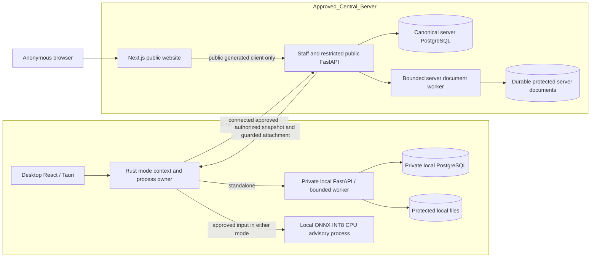

# Product scope and acceptance

This specification defines the agreed product for internal staff of one recruitment agency. No application exists at this baseline. Phase 01 verifies definitions and traceability only. Runtime evidence for every later-owned requirement starts UNVERIFIED.

## 1. Authority and reading order

The original supplied objective is preserved in [the Phase 01 prompt](../phases/PHASE_01_PRODUCT_SCOPE_AND_ACCEPTANCE.md). Read this document with [quality](QUALITY_ACCEPTANCE.md), [release](RELEASE_CONTRACT.md), [local AI](LOCAL_AI_CONTRACT.md), [deferred scope](DEFERRED_SCOPE.md), [decisions](../DECISIONS.md), [status](../STATUS.md) and [phase order](../phases/PHASE_INDEX.md). These are this project's authorities. No other recruitment project contributes implementation, approval or gate evidence.

MUST means mandatory agreed behavior. A requirement's Owner is the primary implementation/qualification phase; supporting phases are named in quality scenarios. Each table row defines a stable ID and acceptance `AC-<ID>`. All rows use Given/When/Then, abbreviated G/W/T. Table cell text is normative. Phase 01 checks the definition of every row; it does not execute its future acceptance. A future specification change appends a decision and affected verification, rather than silently removing an ID.

## 2. Purpose, actors and permissions

Staff need to assess a candidate for a specific position using reviewed facts, explicit rubric versions, repeatable scores and inspectable evidence. Staff retain hiring responsibility. Public applicants need approved job information and a submission receipt, without creating accounts. Companies are client company records; they have no employer login.

| Actor | Permitted work after required authority checks | Restricted work |
| --- | --- | --- |
| Workspace admin | Local workspace setup; current agency memberships/roles; policy activation; company/position/rubric/candidate work; connected publication/intake review; reports; removal/restore; reasoned terminal reopening; authorized erasure and backup/upgrade operations | Cannot bypass purpose/consent, access another agency, bootstrap central-server admin from desktop or turn off scoring/security invariants |
| Recruiter | Authorized company/position/JD/rubric drafting; candidate/application/document/profile review; evaluations, advice review, manual non-admin stage moves; reports; connected publication and intake review under active publication policy; removal/restore of eligible operational records | Cannot manage staff/roles, activate privacy/resource policies, execute erasure, reopen terminal applications or perform operator-only deployment |
| Anonymous visitor/applicant | Browse/search published jobs; read approved detail; submit text PDF and contact/explicit purpose consent to a currently open publication | No staff session, arbitrary tenant selection, private records, submission list, score or candidate existence probe |
| Central server operator | Provision/deploy approved server and initial server staff authority; configure TLS, storage and server secrets | No implicit recruitment-data access from operator status; app-level staff access still requires membership/purpose/consent |
| Owned service/process | Bounded task with current restricted grant, record versions and final authorization check | No unrestricted tenant context or standing authority inferred from a queued task |

One workspace selects one agency. A second synthetic agency exists only for isolation tests; no multi-agency management UI. Local staff identity belongs to the standalone workspace. Connected staff identity and membership belong to the approved central server. A user's OS login alone does not constitute a staff session.

## 3. Terms and data model

CV/resume means an applicant's text-PDF document. JD means job description. A rubric contains criterion definitions, exact weights, mandatory predicates and rating adapters. An application links one candidate to one position with its own stage and evaluation history. An evaluation is immutable canonical output for pinned facts and calculation definition. An advisory run contains separate AI/rule/template outputs. A privacy epoch is a tenant/person/purpose reuse boundary that is invalidated by erasure. A realm is either one local workspace or one approved server; records and credentials cannot cross it implicitly.

| Concept | Content, relations and immutability |
| --- | --- |
| Agency / workspace | Agency scope and versioned policy references. A local workspace owns one local database/files/identity; a connected server owns canonical connected records. Second agency is test-only. |
| Staff identity / membership | Server- or workspace-owned identity, active membership and role; credential/session/device references separated by realm. Membership is checked before tenant context. |
| Company | Agency-owned client metadata and current revision/removal state. One company has positions. |
| Position | Agency/company reference, current operational revision, role title and lifecycle. Links immutable JD and rubric versions; public publication is a separate object. |
| JD version | Immutable approved/draft job text content, author, attribution, revision and content definition. Editing creates a new version; publication pins approved content. |
| Rubric version / criterion | Immutable criterion keys, job-relevant definitions, exact weight, rating adapter/version, evidence requirements, mandatory predicate/version and any fixed reference date. Criterion order is stable. |
| Candidate | Agency-owned person/contact record, provenance, permitted purpose and privacy epoch. One candidate may have several applications and resume/profile revisions. |
| Application | Candidate + position in one agency, received stage initially, optimistic revision, explicit decision and stage-event history. Stage belongs here, never on the candidate globally. |
| Resume/document version | Immutable byte/content provenance, protected file intent/object, media validation, source, consent and retention policy links. Duplicate provenance does not alter factual/calculation equality. |
| Extraction / evidence span | Versioned parser/normalization result with page/text offsets and immutable semantic locator; incomplete/failed extraction is explicit. Evidence access remains protected. |
| Fact/profile revision | Attributed reviewed facts, confirmations/Unknown, evidence references and prior revision; correction creates a new revision. Extracted text is a source assertion, not automatically confirmed truth. |
| Canonical evaluation / component | Calculation definition and factual identity, exact component arithmetic, final total or null, mandatory status, semantic evidence and provenance links. History is immutable except authorized privacy erasure. |
| Publication | Approved public projection for agency/position, pinned JD/public fields, revision/open/expiry state; no private rubric/candidate DTO. |
| Public submission / intake decision | Server-resolved publication authority, contact data, purpose consent version, durable PDF intent, opaque receipt, idempotency scope and review state. Staff explicitly create/link candidate/application after review. |
| Advisory run / review / question revision | Input/evidence authorization, model/rule/template manifests, advisory rank/findings/questions, execution metadata and staff review; canonical evaluation is a separate relation. Edited questions retain attribution. |
| Policy version / task / audit / export / erasure | Versioned source/purpose/consent/retention/resource policies; bounded task grants; transaction audit; protected export intents; erasure/recovery receipts without recoverable personal payloads. |

Phase 03 owns physical relational design, constraints and forward migrations. This logical model requires tenant-consistent references, no orphan final records, and explicit immutable history. It does not prescribe an invented physical schema or claim persistence exists.

## 4. Required workflows and failures

The core demonstration is company → position/JD/rubric → candidate/text PDF → reviewed facts → deterministic score/evidence/Vietnamese explanation → staff stage → CSV/PDF. Repeat it for the same candidate and a second position to demonstrate job-specific results. AI advice supplements the review; it is required but does not supply numeric rating inputs.

Connected demonstration: an authenticated staff member approves and publishes a job; an anonymous visitor browses/searches/reads it, submits a valid text PDF/contact/consent, then receives a durable safe receipt. Connected staff review the inbox and explicitly create/link a candidate/application. Unpublish/expiry/revocation between form opening and final commit rejects a new submission and recovers pending files.

Standalone demonstration: launch offline, establish local identity through native-owned bootstrap, work with local files/data and run genuine local AI. Connected demonstration: choose the configured HTTPS realm, authenticate there, use server canonical records and obtain approved evidence snapshots for local Windows AI. A connection failure blocks connected work. Switching modes is explicit, revokes/clears active authority and prevents stale results from appearing in the other realm.

## 5. Product requirements and acceptance

### Scope and governance

| ID | Owner | Actor/precondition and required behavior | Failure behavior | Acceptance |
| --- | --- | --- | --- | --- |
| GOV-001 | 01 | Phase author establishes this independent baseline, required authorities, stable IDs, ownership and acceptance for the entire amended scope. | Missing authority, unmapped requirement or unresolved Phase 01 contract contradiction stops this gate. | G new folder; W baseline reviewed; T all required documents and phase ownership exist with runtime UNVERIFIED. |
| GOV-002 | 01 | Main agent performs bounded specification-only work and its own review, preserving unrelated files. | No code/install/future execution or fabricated independent review. | G Phase 01; W file inventory compared; T only documented specification/evidence files are added and self-review is identified. |
| GOV-003 | 01 | Phase author records exact ordered prompt names, gate semantics, predecessor and reviewer policy. | No skipped/merged/concurrent phases or invented future prompt. | G no predecessor; W order inspected; T NONE is recorded for 01 and only 02 is next after 01 PASS. |
| GOV-004 | 18 | Handoff owner distinguishes implemented, verified, required, deferred and unresolved evidence; preserves historical scope and affected amendment checks. | Older-scope PASS cannot qualify new scope. | G changed scope or missing evidence; W ledger reconciled; T affected ownership and gaps remain explicit and certification is never inferred. |

### Staff domain work

| ID | Owner | Actor/precondition and required behavior | Failure behavior | Acceptance |
| --- | --- | --- | --- | --- |
| DOM-001 | 06 | Authorized admin/recruiter creates/edits/removes/restores company records in the current agency using revision guards. | Invalid fields, referenced removal policy or stale revision yields actionable error without partial write. | G current agency/company revision; W valid edit then stale edit; T first commit audited, second rejected. |
| DOM-002 | 06 | Staff creates position under an authorized company and saves immutable JD/rubric versions with attribution. | Wrong-agency company or invalid weights/adapters cannot commit. | G valid position versions; W new JD/rubric saved; T previous content remains readable and unchanged. |
| DOM-003 | 07 | Staff creates candidate/contact/source records and applications for several positions with separate received stages. | Invalid purpose/consent, foreign position or duplicate operation cannot create partial links. | G one candidate/two positions; W authorized applications created; T each has separate history, stage and evaluation references. |
| DOM-004 | 08 | Staff attaches validated protected text-PDF resume versions with durable finalization. | Unsupported/scanned-only/encrypted/malformed/over-limit PDF has explicit status, no fabricated text or success. | G valid and rejected PDFs; W upload/preview; T only finalized authorized document is readable and failure leaves recoverable intent. |
| DOM-005 | 09 | Staff inspects page/text evidence and confirms/corrects facts as immutable attributed profile revisions. | Parser uncertainty, missing span or conflicting revision stays explicit; no inferred fact becomes confirmed silently. | G reviewed profile; W correction committed; T new revision cites actor/reason/evidence and old facts remain unchanged. |
| DOM-006 | 11 | Staff requests official evaluation for an application with pinned reviewed facts/JD/rubric and reads components/evidence/Vietnamese explanation. | Revoked authority, incomplete facts or obsolete selection cannot produce claimed complete result. | G application and pinned inputs; W evaluate; T persisted output identifies versions and total/null status and leaves stage unchanged. |
| DOM-007 | 13 | Staff completes the core demo on actual DB/API/files using synthetic CVs in both execution modes as applicable. | Mock-only/fixture-only output cannot qualify this flow. | G current development source; W both documented demonstrations run; T evidence traces company through score/stage/CSV/PDF and public intake. |

### Stage contract

Exactly five stage values are `received`, `evaluating`, `interview`, `hired`, `not_continuing`. UI labels are respectively `Đã nhận`, `Đang đánh giá`, `Phỏng vấn`, `Đã tuyển`, `Không tiếp tục`. Labels are presentation; persisted state keys and permitted transitions are fixed domain invariants.

| From | To | Actor/condition |
| --- | --- | --- |
| received | evaluating | Authorized admin/recruiter, explicit action |
| evaluating | interview | Authorized admin/recruiter, explicit action |
| interview | hired | Authorized admin/recruiter, manual hiring decision |
| received / evaluating / interview | not_continuing | Authorized admin/recruiter, explicit decision |
| evaluating | received | Authorized admin/recruiter, nonblank reason |
| interview | evaluating | Authorized admin/recruiter, nonblank reason |
| hired / not_continuing | received | Admin only, nonblank reason and attributed reopening |

Every other transition is rejected. Every successful event records actor, from/to, application revision and audit time. Time is audit metadata, never a calculation input. Decision/reason payload is part of the guarded commit; backward/reopening reason is mandatory. An unchanged-stage retry is idempotent under the same authorized operation key.

| ID | Owner | Actor/precondition and required behavior | Failure behavior | Acceptance |
| --- | --- | --- | --- | --- |
| STG-001 | 07 | Stage API enforces exactly the table above on a current application revision. | Unlisted transition or stale revision changes nothing. | G received; W direct hired request then evaluating request; T direct move rejected, evaluating audited. |
| STG-002 | 07 | Staff provides reason for evaluating→received and interview→evaluating; only admin reopens either terminal to received with reason. | Blank reason, recruiter reopening or terminal-to-interview request is rejected. | G terminal and backward cases; W allowed/disallowed role/reason combinations; T only specified combinations commit. |
| STG-003 | 11 | Staff decides hiring/stage manually with visible confirmation and backend-confirmed state. | Score/advisory completion, retry or threshold cannot trigger a stage event. | G any evaluation including high score or finding; W result arrives; T application stage is unchanged until staff action. |

### Canonical score shared contract

Each criterion has stable key, job-relevant definition, exact nonnegative decimal/rational weight, rating adapter/version, evidence requirements, null-handling definition and optional mandatory predicate. Active rubric weights MUST sum exactly to 100. Ratings are integers 0, 1, 2, 3, 4 or null (Unknown). The labels 0–4 are a range, not a generic interchangeable adapter. Each criterion's immutable adapter maps reviewed facts to these values with complete thresholds, units, inclusivity, absent/contradictory cases and evidence rules. Manual ordinal ratings also require an immutable anchored definition, authorized reviewer and cited facts. AI similarity never maps to ratings.

For all positively weighted known ratings, exact component contribution is `weight * rating / 4`. Exact total is `sum(weight * rating) / 4`. Preserve exact arithmetic throughout. Round the final nonnegative total to integer using half-up only (`floor(exact_total + 0.5)`), never intermediate rounding or binary floating-point as canonical arithmetic. If any positive-weight rating is null, exact and integer totals are null; preserve known components and list missing criteria. A zero-weight Unknown does not prevent numeric total, but may leave a separate mandatory predicate Unknown. Never replace null with 0, average known values or renormalize weights.

Mandatory predicates yield pass/fail/unknown. Aggregate status is fail if any predicate fails, unknown if none fails and at least one is unknown, otherwise pass; an empty mandatory set passes. Numeric completeness is complete/incomplete separately. Neither status prescribes hiring or stage. This chosen fixed aggregation is recorded in decisions and included in calculation pins.

Calculation identity includes factual content in canonical form, document bytes/extraction and semantic evidence definition, JD/rubric content/version definitions, criterion order/keys, adapter and mandatory-predicate versions, fact-normalization/extraction rules, exact weight/rating representation, scoring implementation/contract version, Unknown/rounding rules, and any explicitly fixed reference date/calendar rules. Record both full definition and its integrity identity; a hash alone is not authority. Pin fact content separately from revision/upload provenance IDs. Transport IDs, filenames, host/port, request/upload IDs, current clock and display language are excluded. Evidence equality compares semantic page/span/criterion content; occurrence-specific authorized file links and audit provenance may differ without changing components/evidence meaning. Any date-dependent criterion must supply its immutable reference date; never silently use today.

Reuse identity is additionally confined to current realm, tenant, person, purpose and privacy epoch. Equal inputs permit reuse only after current authority checks. Erasure destroys personal outputs, embeddings, hashes and reusable caches; later reupload gets a new privacy epoch and cannot restore erased history or discover past existence through equality.

| ID | Owner | Actor/precondition and required behavior | Failure behavior | Acceptance |
| --- | --- | --- | --- | --- |
| SCR-001 | 06 | Rubric author defines exact weights totaling 100 and complete criterion rating/mandatory adapters. | Invalid range, sum, undefined adapter branch or protected-trait criterion prevents rubric activation. | G valid/invalid rubrics; W validate; T only exact 100 and complete job-relevant definitions activate. |
| SCR-002 | 10 | Scorer computes exact components/total with ratings 0–4 and final half-up integer only. | NaN, out-of-range rating or approximate canonical arithmetic is rejected. | G weights 50/50, ratings 1/0; W score; T exact 12.5 and integer 13; known all-4 yields 100. |
| SCR-003 | 10 | Scorer persists null Unknown and separate numeric/mandatory completeness using the stated aggregation. | No missing-rating default or weight renormalization. | G weights 60/40 and ratings 4/null; W score; T known contribution 60, total null and missing criterion; mandatory state evaluated separately. |
| SCR-004 | 10 | Scorer pins full immutable factual/calculation/evidence content including fixed date for date-dependent adapters. | Missing required pin/date or altered definition cannot reuse a result. | G same input and definition; W retry/restart/change clock/filename/host/upload ID/language; T identical components/total/status/semantic evidence. |
| SCR-005 | 10 | Scorer remains job-specific; identical candidate may have different rubric results. | 70 has no special branch; advisory model/template update cannot re-score history. | G golden inputs producing 69/70/71 and two positions; W score and change AI version only; T arithmetic outputs hold and canonical identity stays fixed under AI-only change. |
| SCR-006 | 10 | Vietnamese explanation projects stored facts/components/missing criteria/mandatory results. | Explanation rendering cannot set rating, total or confirmed fact. | G persisted output; W render Vietnamese and another UI language; T numbers/identity unchanged and each claim points to stored evidence. |
| SCR-007 | 09 | Reviewer confirms job-relevant facts; protected/personal traits are excluded from numeric features and advisory discriminatory rules. | Names/contact, age/birth, gender, ethnicity, religion, health/disability and similar protected traits cannot become score features. | G synthetic resumes differing only in protected traits; W review/scoring; T job facts and canonical result are unaffected and exclusions are inspectable. |
| SCR-008 | 10 | Authorized reuse respects tenant/person/purpose/privacy epoch and equality cannot reverse erasure. | Foreign or erased cache entry is unusable and no existence signal is returned. | G equal bytes in second agency or post-erasure epoch; W evaluate; T fresh authorized processing without cross-boundary reuse or recovered history. |

### Public website and connected operations

Public projection permits only approved agency display name, company display name when approved, publication identifier, role title, location/work arrangement, employment type, approved JD text, application instructions and current application-open/expiry information. Optional fields remain absent unless approved; names do not imply a company account. Internal agency/position IDs, staff contacts, private rubric/notes and any candidate/application/score/count/hash are excluded. Phase 02 gives this allowlist exact generated types. Search/filter uses approved title, location/work arrangement and employment type only, with configured bounded pagination; it cannot search private candidate/company notes.

Intake requires applicant-provided name, at least one validated email or phone contact, a validated text PDF and explicit non-preselected purpose consent referencing the displayed active policy version. A job's application instructions are public display data, never permission to change authority or invoke integrations. Safe receipt means accepted for staff review, not identity matching, hiring or a complete evaluated candidate. Exact contact validation/length/resource schemas belong to Phase 02 and cannot silently adopt a personal dataset or legal retention period.

| ID | Owner | Actor/precondition and required behavior | Failure behavior | Acceptance |
| --- | --- | --- | --- | --- |
| PUB-001 | 06 | Connected staff approves explicit public fields/JD and publishes/unpublishes versioned jobs under active agency policy. | Standalone publish, invalid approval or stale publication revision is rejected. | G authorized connected staff; W publish then unpublish; T browse/detail expose the approved projection only while open. |
| PUB-002 | 06 | Anonymous visitor browses/searches/filters/details currently published jobs with bounded pagination and safe query handling. | Empty/no match/invalid query and unpublished/expired detail have safe states without private counts. | G published/closed jobs; W title/search/filter/detail; T only approved open results appear and current publication is checked. |
| PUB-003 | 08 | Applicant submits validated text PDF, required contact/name and explicit versioned recruitment-purpose consent to the current publication. | Missing consent/contact, invalid PDF or closed publication yields safe field/task error without intake success. | G current job/form; W valid submission finalizes; T durable intake/consent/file intent and opaque receipt exist, without candidate creation. |
| PUB-004 | 08 | Server resolves publication→agency/position, checks open/expiry/quota/resource/consent/idempotency at final commit and finalizes files durably. | Arbitrary tenant header/job substitution, publication race or exceeded quota rejects and recovers pending files. | G form open before unpublish/expiry; W finalize later; T no new accepted intake, no orphan final object and safe rejection. |
| PUB-005 | 08 | Restricted public receipt reveals accepted-for-review status and opaque receipt only after durable acceptance. | Receipt/duplicate response never exposes candidate existence, CV/hash, score, staff fields or private totals. | G duplicate/foreign probes; W submit/inspect public responses; T no private signal or unguarded submission lookup. |
| PUB-006 | 07 | Staff intake-review contract permits explicit accept/reject and create/link after human review in the current agency. | No automatic person merge based on email/name/hash; stale or revoked review grant commits nothing. | G two submissions with same contact; W staff reviews; T explicit attributed link/create decision and no automatic merge. |
| PUB-007 | 08 | Connected inbox implements protected review, safe preview and idempotent candidate/application linking. | Foreign/stale intake or missing file finalization cannot link partially. | G current reviewed intake; W accept with candidate choice twice; T one guarded linked result with audit and protected file authority. |
| PUB-008 | 17 | Public site/connected flows qualify on user-approved synthetic HTTPS infrastructure, independent of standalone qualification. | Missing approved environment is network qualification STOP; no paid signup/publication without authorization. | G approved staging origins; W anonymous intake and connected review run; T actual HTTPS/CORS/cache/abuse boundary evidence is saved. |

## 6. Interfaces and error semantics

| Boundary | Required contract and owner |
| --- | --- |
| Staff API | Generated TypeScript client from actual staff OpenAPI; auth, current revision and idempotency contracts; private DTOs tenant/purpose protected. Contract 02, identity 04, domain endpoints 06–12. |
| Public API | Separately generated allowlisted schema/client for publication list/search/detail and intake/receipt response only. Public bundle contains no staff credentials, private DTOs, Tauri/native modules or inference. Contract 02, execution 06/08. |
| Native bridge | Rust obtains validated context and owns local HTTP services/device authority. Connected bridge uses approved HTTPS and realm credentials. UI does not invent ports, token IDs or local/server administrator authority. Contract 02, runtime 14/15. |
| Document worker/storage | API grants bounded purpose/version tasks; storage intent then durable finalization/recovery. Read/preview/export requires current permission. Contract 02, files 08, parsing 09. |
| Windows AI | Local bounded process receives only approved evidence/snapshot manifest; attaches separate advisory output under server checks. Details in local AI contract; contracts 02, inference 10/15. |

Phase 02 defines exact route names, request/response types, setting schemas and generated operation IDs. This phase does not invent API implementations. Error envelope must contain stable actionable code, safe Vietnamese message, relevant field/version action and nonsecret correlation reference; never SQL, secrets or raw CV text. Error classes cover authentication required/expired, authorization revoked, policy/consent expired, invalid input/unsupported PDF, quota/limit, missing setting/model, task timeout/cancel/failure, revision conflict, unavailable server and durable recovery pending. Success means confirmed commit/finalization, not optimistic UI or task scheduling alone.

## 7. Verification, rationale and dependencies

The agreed component topology below defines ownership, not deployed services. Phase 02 turns it into exact module/API/configuration/model contracts and a verified toolchain.

There is no local-to-server database replication edge. AI process inputs/outputs travel through the chosen native authority; canonical scoring remains an exact application-domain calculation in the chosen local/server API realm. No AI inference exists in public web or the central worker. Docker Compose may host development/test central dependencies; it is not in the recipient launch path.

Future unit/golden checks prove exact arithmetic and state definitions; integration checks use actual PostgreSQL/API/files; Windows/native/offline/network checks qualify their environments. Required checks and measurements are defined in quality, release and AI documents. No coverage percentage, hardware minimum, processing speed or legal retention duration is invented here. Threshold owners must approve/version unresolved measurement targets before their qualification gate.

Tauri 2 with React/TypeScript/Vite supplies the required Windows shell. Next.js/React/TypeScript owns only the required public website. FastAPI/PostgreSQL with Alembic owns canonical staff/public boundaries and schema history. Private runtimes enable offline zero-recipient-setup operation; Docker Compose is development/test tooling only. Local pretrained embedding inference supplies advisory evidence without external AI calls or free-form text generation. Each dependency is required by the supplied objective, with compatible patch versions/licenses owned by Phase 02 and release manifest phases.

Official references are recorded with scope and access date in [decisions](../DECISIONS.md). They support feasibility/contract choices, not evidence of implementation, legal approval or model quality in this product. The final Phase 01 definition/link/ownership review appears in [verification](../phases/PHASE_01_VERIFICATION.md).

## Phase 05 amendment (2026-10-14)

The separately supplied Phase 05 prompt and user roadmap choice supersede remaining 18-phase numbers. Original definitions/IDs/dated evidence above remain intact. Current owner mappings are in [ACCEPTANCE_LEDGER](ACCEPTANCE_LEDGER.md) and exact order in [PHASE_ROADMAP](../architecture/PHASE_ROADMAP.md). Release payload recipes are Phase 34, GitHub-hosted Windows x64 builds Phase 40, clean offline qualification Phase 41, approved HTTPS Phase 42, and final measurements/handoff Phases 43–45. Packaging is per-user NSIS with retained LocalAppData data and single-EXE portable with a writable local NTFS sibling workspace. No local/self-hosted recipient-PC release packaging, automatic public Release or deployment is authorized. Runtime behavior remains UNVERIFIED at its new owner.
